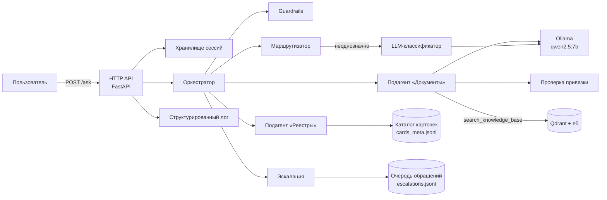
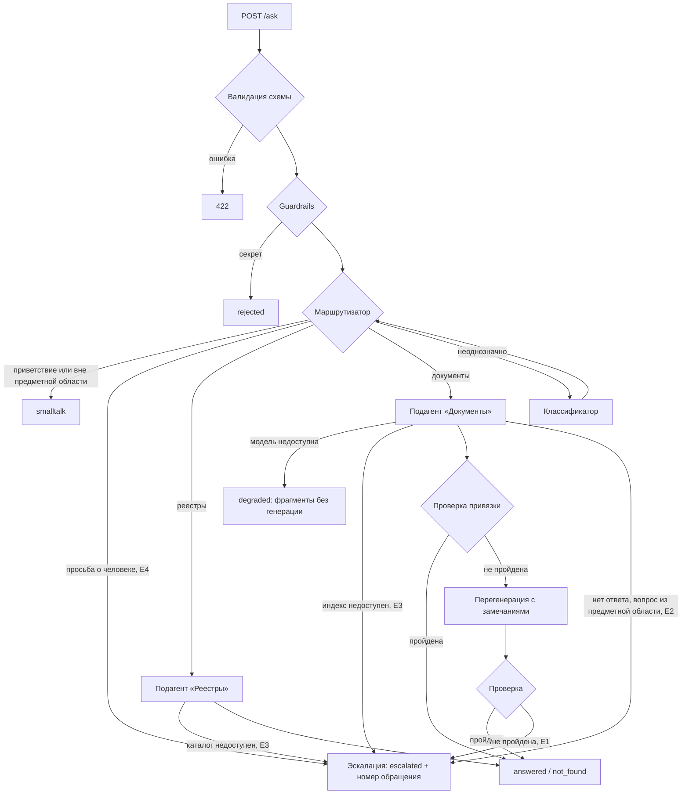
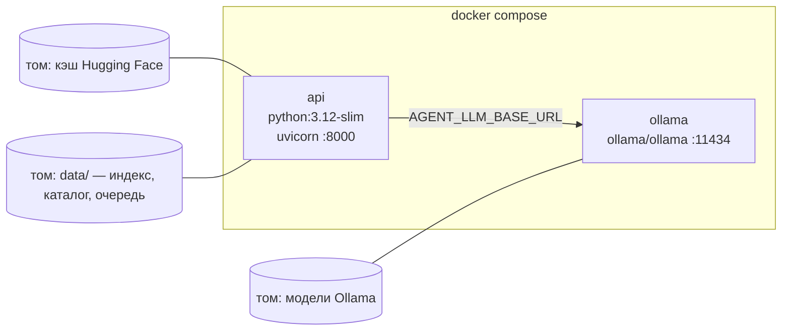

# Архитектура сервиса

Шаг 3 итоговой работы: компоненты и обмен данными, формат HTTP API, конфигурация, точки логирования, обработки ошибок и автоматической проверки. Ссылки на требования — `F`, `Q`, `S`, `E`, `R` из [requirements.md](requirements.md).

## 1. Компоненты

В baseline вся логика живёт в одном классе `KBAgent` (`src/agent.py`, 761 строка): цикл LLM, правила перечислений по каталогу, память, проверка ответа. Итоговая версия разделяет его на оркестратор, маршрутизатор и два подагента. Инструменты, каталог, клиенты модели, guardrails и память переиспользуются без изменений.



| Компонент | Ответственность | Модуль | Основа |
|---|---|---|---|
| HTTP API | Приём и валидация запросов, сессии, формат ответа, коды ошибок, `/health` | `src/service/api.py`, `schemas.py`, `sessions.py`, `health.py` | новый |
| Оркестратор | Порядок шагов: guardrails → маршрут → подагент → проверка → эскалация → ответ; один `request_id`, trace | `src/agents/orchestrator.py` | из `KBAgent.run` |
| Guardrails | Тип, длина, секреты; фиксация явных параметров пользователя | `src/agent_guardrails.py` | без изменений |
| Маршрутизатор | Выбор маршрута по правилам; классификатор — только для неоднозначных вопросов | `src/agents/router.py` | из `KBAgent._route_catalog` + новый классификатор |
| Подагент «Реестры» | Перечисления, люди по прошлому ответу, рейтинги, проекты сотрудника; ответ без генерации | `src/agents/registry_agent.py` | из `KBAgent._route_catalog`, `_catalog_answer`, `agent_cards.py` |
| Подагент «Документы» | Цикл LLM с одним инструментом поиска; фильтр документа только из текста вопроса | `src/agents/documents_agent.py` | из цикла `KBAgent.run`, урезанная схема инструментов |
| Проверка привязки | Каждое утверждение ответа сверяется с процитированным фрагментом; одна перегенерация | `src/agents/grounding.py` | развитие проверки ссылок и чисел из `_compose_final` |
| Эскалация | Инструмент `escalate_to_human`: обращение в очередь, ответ пользователю | `src/agents/escalation.py` | новый |
| Хранилище сессий | Память диалога по `session_id`: TTL, лимит числа сессий | `src/service/sessions.py` | обёртка над `ShortTermMemory` |
| Лог | JSON-строки в stdout без текста вопросов и ответов | `src/service/logging.py` | новый |

`KBAgent` остаётся тонкой обёрткой над оркестратором, поэтому `agent_cli.py`, `scenario_runner.py` и 12 исходных сценариев работают без изменений (Q5).

## 2. Обработка запроса



### Маршрутизатор

Правила проверяются по порядку, первое сработавшее определяет маршрут. Правило и признаки записываются в trace (F3).

| Порядок | Правило | Маршрут |
|---|---|---|
| 1 | Guardrails отклонили запрос | `rejected` |
| 2 | Приветствие, благодарность | `smalltalk` |
| 3 | Просьба связаться с человеком («соедините», «передайте ответственному», «свяжитесь») | `escalation` (E4) |
| 4 | Вопрос о людях по карточкам прошлого ответа сессии | `registry` |
| 5 | Перечисление, подсчёт или рейтинг с отраслью, типом услуги, периодом, сотрудником или типом реестра и без посторонней темы | `registry` |
| 6 | Название продукта или документа из индекса либо тема без признаков реестра | `documents` |
| 7 | Признаков предметной области нет (продукты, реестры, отрасли, услуги, фамилии из каталога) | классификатор: `documents`, `registry` или `smalltalk` (вне предметной области) |

Классификатор — отдельный короткий вызов модели без инструментов: промпт до 300 токенов, ответ — одно слово из списка. Если модель недоступна, по умолчанию выбирается маршрут `documents`.

Маршрут в ответе — это итоговый обработчик, `route_path` — вся цепочка. Например, `["documents", "escalation"]` значит: подагент «Документы» не нашёл ответа на вопрос из предметной области, и вопрос ушёл в эскалацию E2.

### Подагент «Документы»

- **Схема инструментов** — только `search_knowledge_base(query, top_k)`, без `category`, `industry`, годов и `list_cards`. Фильтры и каталог относятся к реестрам. Цель — промпт шага выбора инструмента не больше 900 токенов (Q7).
- **Фильтр по документу** ставит не модель, а код: если в вопросе есть название продукта из метаданных индекса (ERGO, SIPS, AIMS, IBP, Integral 360), поиск ограничивается этим документом, и это записывается в trace. Так закрывается регрессия `main_ergo` (F5).
- **Перенесено из baseline без изменений:** лимит итераций, принудительный поиск, разбор вызова инструмента из текста, деградация.

### Проверка привязки (Q1, E1)

1. Ответ режется на утверждения: предложения и пункты списков. Утверждения, где меньше 3 значимых слов (связки, заголовки, «Источники: …»), не проверяются.
2. Утверждение считается подкреплённым, если в нём или в конце его абзаца есть ссылка `[Фрагмент N]` на реально полученный фрагмент и выполнены оба условия:
   - доля значимых основ утверждения, которые есть в тексте этого фрагмента, не ниже `grounding.min_overlap` (по умолчанию 0,5);
   - все числа утверждения есть во фрагменте.
3. Ответ подкреплён, если подкреплены все утверждения. Иначе модель один раз перегенерирует ответ с перечнем неподкреплённых утверждений, и проверка повторяется. Повторный провал — эскалация E1.

Это лексическая проверка. Она ловит утверждения без ссылки, ссылки «не туда» и числа, которых нет во фрагменте. Перефразирование с другими словами и неверную логику при верных словах она не ловит. Так это и будет описано в README: без формулировок «гарантирует привязку».

### Эскалация (F6)

Обращение записывается строкой в `escalations.jsonl`:

```json
{"id": "ESC-20261102-0007", "created_at": "2026-11-02T16:40:12+03:00", "status": "new",
 "reason": "no_data", "owner": "Владелец базы КП", "route_path": ["documents", "escalation"],
 "question": "Сколько стоит годовая лицензия на SIPS…", "evidence": [{"type": "document", "id": "02_sips_investment_planning.pdf#5"}],
 "request_id": "c1f0…", "profile": "public"}
```

- **Ответственные** — это роли, а не люди. Они задаются в конфигурации; имена и контакты в репозиторий не попадают.
- **Текст вопроса** хранится только в очереди, которая лежит в `.gitignore`. В лог он не пишется (S2).
- **Запросы с секретом** до эскалации не доходят: их раньше отклоняют guardrails (S3).

## 3. HTTP API

### `POST /ask`

Запрос:

```json
{"question": "Какие проекты были в медицине?", "session_id": "3f2c9a1e-…"}
```

| Поле | Тип | Ограничения |
|---|---|---|
| `question` | строка | обязательно, 1–1 000 символов после обрезки пробелов |
| `session_id` | строка | необязательно, до 64 символов `[A-Za-z0-9-]`. Если не передан, сервис создаёт новый и возвращает его в ответе |

Профиль базы в запросе не передаётся: его задаёт конфигурация сервиса. Пользователь API не может переключиться на полную базу.

Ответ — 200 для всех исходов работы агента, включая `not_found`, `escalated`, `rejected` и `degraded`:

```json
{
  "request_id": "c1f0b7d2-…",
  "session_id": "3f2c9a1e-…",
  "status": "answered",
  "route": "registry",
  "route_path": ["registry"],
  "answer": "В реестрах найдено (отрасль: Pharma & HC): 4. …",
  "sources": [
    {"type": "card", "id": "project:12", "title": "…", "year": 2021, "industry": ["Pharma & HC"]},
    {"type": "document", "id": "01_ergo_business_simulator.pdf#2", "title": "ERGO — …", "score": 0.86}
  ],
  "escalation": null,
  "warnings": [{"code": "filter_dropped", "message": "…"}],
  "grounding": {"checked": true, "units": 5, "supported": 5, "regenerated": false},
  "duration_ms": 412,
  "llm_calls": 0
}
```

| `status` | Когда |
|---|---|
| `answered` | ответ есть; для маршрута `documents` — проверка привязки пройдена |
| `not_found` | маршрут `registry`: по условиям карточек нет |
| `escalated` | сработало правило E1–E4; в `escalation` — `{id, reason, owner}` |
| `smalltalk` | приветствие или вопрос вне предметной области |
| `rejected` | guardrails: секрет в запросе |
| `degraded` | модель недоступна; в `sources` — найденные фрагменты, генерации нет |

Ошибки — единый формат `{"error": {"code", "message", "request_id"}}`:

| HTTP | `code` | Когда |
|---|---|---|
| 422 | `invalid_request` | нет `question`, не строка, пустая строка, длиннее 1 000 символов, некорректный `session_id`, некорректный JSON |
| 500 | `internal_error` | непредвиденное исключение. Сообщение общее, без traceback, путей и конфигурации; подробности — в логе по `request_id` |
| 503 | `service_unavailable` | сервис не инициализирован: не загружена конфигурация или индекс при старте |

### `GET /health`

```json
{"status": "ok", "version": "1.0.0", "profile": "public",
 "components": {"llm": {"status": "ok", "model": "qwen2.5:7b-instruct"},
                "index": {"status": "ok", "points": 89},
                "catalog": {"status": "ok", "cards": 40}}}
```

200, если модель и индекс доступны. 503, если недоступен хотя бы один из них; в `components` видно какой. Каталог необязателен: без него `status` = `degraded`, код 200, маршрут `registry` эскалирует по E3. Модель проверяется запросом `GET /api/tags` к Ollama с таймаутом 2 с: сервер отвечает, и нужная модель загружена.

## 4. Конфигурация

Все изменяемые параметры — в `config/agent.yaml` (существующий файл, добавляются секции) и в переменных окружения. Переменные окружения перекрывают YAML (F9).

| Секция `agent.yaml` | Параметры | Новое |
|---|---|---|
| `llm` | модель, адрес, temperature, seed, `num_ctx`, `max_tokens`, таймаут, `keep_alive` | — |
| `agent` | профиль, лимит итераций, вызовов инструментов, принудительный поиск | — |
| `tools`, `context`, `memory`, `guardrails` | top_k, лимиты запроса и контекста, размер памяти | — |
| `router` | включение классификатора, его таймаут, маршрут по умолчанию | да |
| `grounding` | `min_overlap` (0,5), минимум значимых слов в утверждении (3), число перегенераций (1) | да |
| `escalation` | путь к очереди, роли ответственных по причинам E1–E4 | да |
| `service` | хост, порт, TTL сессии (30 мин), лимит сессий (200), уровень и формат лога | да |

| Переменная окружения | Значение по умолчанию | Зачем |
|---|---|---|
| `AGENT_PROFILE` | `public` | профиль базы; `full` — только во внутреннем контуре |
| `AGENT_LLM_BASE_URL` | `http://localhost:11434` (в Docker — `http://ollama:11434`) | адрес Ollama |
| `AGENT_LLM_MODEL` | `qwen2.5:7b-instruct` | модель |
| `AGENT_RETRIEVER` | `qdrant` | `lexical` — для проверки без модели эмбеддингов |
| `RAG_EMBEDDINGS_ALLOW_DOWNLOAD` | `1` | `0` — модель эмбеддингов только из локального кэша |
| `ESCALATION_QUEUE_PATH` | `data/escalations/escalations.jsonl` | очередь обращений |
| `LOG_LEVEL`, `LOG_FORMAT` | `INFO`, `json` | лог |

Секретов у сервиса нет: Ollama локальная, внешние API не используются. `.env.example` остаётся один, его содержимое переносится из `env.example` (дефект baseline №4).

## 5. Логирование (S2)

Каждое событие — одна JSON-строка в stdout с полями `ts`, `level`, `event`, `request_id`.

| Событие | Поля | Не пишется |
|---|---|---|
| `request_received` | длина вопроса, есть ли `session_id`, хеш `session_id` | текст вопроса |
| `guardrail_decision` | разрешено, код причины, типы найденных секретов | сам секрет |
| `route_decided` | маршрут, сработавшее правило, использован ли классификатор | признаки из текста вопроса |
| `tool_call` | инструмент, статус, код ошибки, длительность, число результатов | аргументы `query`, `person` |
| `llm_call` | этап, длительность, токены промпта и ответа, успех | промпт и ответ |
| `grounding_check` | утверждений, подкреплено, была ли перегенерация | текст утверждений |
| `escalation_created` | номер обращения, причина, роль ответственного | вопрос |
| `response_sent` | статус, маршрут, число источников, длительность, вызовов LLM | ответ, названия источников |
| `error` | код, класс исключения, место | сообщение исключения: в нём могут оказаться данные |

Названия источников не логируются, потому что в профиле `full` имена файлов коммерческих предложений содержат наименования клиентов.

## 6. Обработка ошибок

| Место | Ситуация | Поведение | Требование |
|---|---|---|---|
| API | некорректный ввод | 422 `invalid_request`, понятное сообщение | S5 |
| API | исключение в обработке | 500 `internal_error` без деталей, событие `error` в лог | S4 |
| Guardrails | секрет в запросе | `rejected` до модели, без записи в память, лог и очередь | S3 |
| Маршрутизатор | классификатор недоступен | маршрут по умолчанию `documents`, предупреждение в trace | S6 |
| «Документы» | модель недоступна | `degraded`: поиск без генерации, фрагменты в `sources` | S6 |
| «Документы» | индекс недоступен | эскалация E3 | S6, E3 |
| «Документы» | модель передала неверный аргумент | повтор поиска без него, предупреждение в `warnings` | F8 |
| «Документы» | лимит итераций | финальный вызов без инструментов (как в baseline) | — |
| Проверка привязки | ответ не подкреплён | одна перегенерация, затем эскалация E1 | Q1, E1 |
| «Реестры» | каталог недоступен | эскалация E3 | E3 |
| Эскалация | очередь недоступна для записи | ответ `escalated` с номером, отмеченным как незаписанный; событие `error` | S6 |
| Сессии | превышен лимит | вытесняется самая старая сессия | — |

## 7. Автоматическая проверка

| Уровень | Что проверяется | Инструмент | Требования |
|---|---|---|---|
| Модульные тесты | маршрутизатор (каждое правило), проверка привязки (подкреплено, без ссылки, ссылка «не туда», чужое число), эскалация (E1–E4, формат обращения), снятие фильтров, сессии | `pytest` + mock-модель | F3, F5–F8, Q9 |
| Тесты API | схема ответа, коды 422/500/503, `/health` при недоступных компонентах, изоляция сессий, отсутствие traceback | `pytest` + FastAPI `TestClient` | F1, F2, S4–S6 |
| Гигиена репозитория | ключи, токены, ФИО вне синтетического списка, коды проектов | `tests/test_repository_hygiene.py` | S1 |
| Логи | вопрос с ФИО и тестовым ключом не попадает в лог | `pytest` с перехватом stdout | S2, S3 |
| Исходные сценарии | 12 сценариев `agent_scenarios.yaml`: mock для CI, живая модель для сравнения | `agent_cli.py --run-scenarios` | Q5 |
| Контрольный набор | 16 сценариев `control_scenarios.yaml` на baseline и итоговой версии, метрики Q1–Q8 | `tools/run_control.py` | Q1–Q8, R1 |
| Развёртывание | `docker compose up` → `/health` 200 → CS-01 и CS-05 через API | `tools/smoke_api.py`, видео | F10 |

### Запуск контрольного набора на двух версиях

Обе версии запускаются **в одном процессе на одних данных**: baseline извлекается из тега в отдельную папку, и `run_control.py` импортирует его агента оттуда.

```bash
git worktree add ../kb_baseline baseline-2026-10-02
python tools/run_control.py --version-dir ../kb_baseline --label baseline
python tools/run_control.py --version-dir . --label final
python tools/run_control.py --compare baseline final     # таблица «до/после» в reports/control/
```

Сбои подменяются одинаково для обеих версий: недоступная модель, недоступный индекс, ответ модели без ссылок. Маршруты baseline переводятся в маршруты итоговой версии по таблице эквивалентов из `control_scenarios.yaml`.

## 8. Развёртывание (F10, S8)



- **Образ `api`** содержит код, конфигурацию и данные `public_v2`. Полная база в образ не входит: `.dockerignore` исключает `data/` кроме `public_v2`. Профиль `full` подключается томом во внутреннем контуре (S8).
- **Индекс `public_v2`** собирается при первом запуске контейнера, если его нет в томе. Модель эмбеддингов скачивается один раз в том кэша, затем `RAG_EMBEDDINGS_ALLOW_DOWNLOAD=0`.
- **Модель qwen2.5** скачивается один раз командой из инструкции (`docker compose exec ollama ollama pull qwen2.5:7b-instruct`, около 4,7 ГБ) и хранится в томе.
- **Проверка** — `docker compose up -d`, затем `GET /health` до 200, затем `tools/smoke_api.py`: CS-01, CS-05 и CS-16 через API. Лог запуска и видео — подтверждение для эксперта.

## 9. План по неделям

| Неделя | Что делается | Результат |
|---|---|---|
| 2 | синтетический реестр и `public_v2`; `run_control.py`; **замер baseline** на контрольном наборе; маршрутизатор, подагенты, проверка привязки, эскалация; промежуточный замер | метрики baseline; Q1–Q4 на новой версии |
| 3 | API, сессии, логирование, обработка ошибок, тесты API и гигиены, Dockerfile | F1, F2, F7–F9, S1–S6, Q9 |
| 4 | docker compose, проверка в чистом окружении, финальный замер, сравнение «до/после», README, презентация, видео, описание для портфолио | F10, S8, итоговые материалы |
